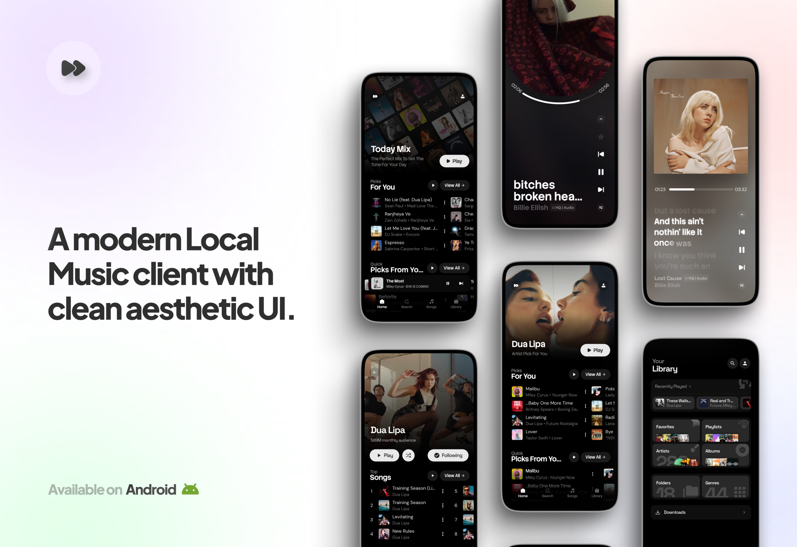

# Looper Player v3.0.2

A battery and smoothness release: a much lighter music bar and a quick way to queue songs.

  

## Download

Not sure which phone type you have? Take `arm64-v8a`.

| Phone type | APK |
|---|---|
| `arm64-v8a` (most phones) | [Download](https://github.com/SthrNilshaaa/looper/releases/download/3.0.2/looper-player-v3.0.2-arm64-v8a-offline-release.apk) |
| `armeabi-v7a` | [Download](https://github.com/SthrNilshaaa/looper/releases/download/3.0.2/looper-player-v3.0.2-armeabi-v7a-offline-release.apk) |
| `x86_64` | [Download](https://github.com/SthrNilshaaa/looper/releases/download/3.0.2/looper-player-v3.0.2-x86_64-offline-release.apk) |
| `universal` | [Download](https://github.com/SthrNilshaaa/looper/releases/download/3.0.2/looper-player-v3.0.2-universal-offline-release.apk) |

Linux and Windows builds are in the assets below.

## What's New

### New
- Album, artist and collection lists: while a song is loaded, the track number becomes an add-to-queue button. Tap again to remove the song

### Improved
- Lower battery use while music plays: the music bar now shows a still cover
- Long titles scroll once per song, then rest
- The Home banner only advances while it is on screen
- New installs start with Blur Background on
- A smoother Now Playing background blur

### Fixed
- Fine lines across the blurred Now Playing background

## Notes

Verify downloads with the `SHA256SUMS-v3.0.2.txt` file.

**Full Changelog**: https://github.com/SthrNilshaaa/looper/compare/3.0.0...3.0.2
