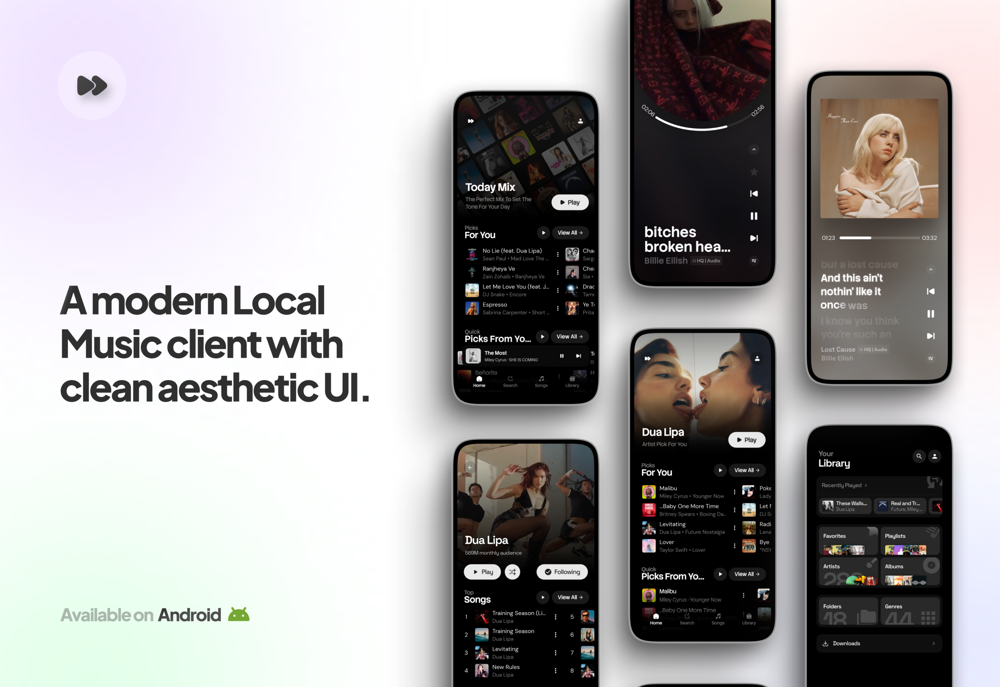

# Looper Player v3.0.3

A new audio engine, more playlist formats, a customizable Library and gentler EQ presets.

  

## Download

Not sure which phone type you have? Take `arm64-v8a`.

| Phone type | APK |
|---|---|
| `arm64-v8a` (most phones) | [Download](https://github.com/SthrNilshaaa/looper/releases/download/3.0.3/looper-player-v3.0.3-arm64-v8a-offline-release.apk) |
| `armeabi-v7a` | [Download](https://github.com/SthrNilshaaa/looper/releases/download/3.0.3/looper-player-v3.0.3-armeabi-v7a-offline-release.apk) |
| `x86_64` | [Download](https://github.com/SthrNilshaaa/looper/releases/download/3.0.3/looper-player-v3.0.3-x86_64-offline-release.apk) |
| `universal` | [Download](https://github.com/SthrNilshaaa/looper/releases/download/3.0.3/looper-player-v3.0.3-universal-offline-release.apk) |

Linux and Windows builds are in the assets below.

## What's New

### New
- Import playlists from M3U, M3U8, PLS, XSPF, WPL, ZPL, SMIL, MPC-HC and AIMP files, with a new Import button on the Playlists page
- Pin playlists or Favorites to the top of Library, and reorder them from Customize Library
- A Reset button for the 18 equalizer bands
- Backups now include your app settings; restoring asks before replacing yours
- A new add-to-queue icon

### Improved
- Audio engine updated to mpv_audio_kit 0.8: equalizer slider drags apply live, without a rebuild
- Built-in EQ presets are half as strong; Bass Booster no longer overpowers the mix
- Playlists: New Playlist and Import buttons at the top instead of floating buttons
- The restore picker finds backup files whatever their file type

### Fixed
- A paused song no longer starts again when a Bluetooth call ends
- During a crossfade, a call now pauses both songs
- Resume on Bluetooth Connect never starts music during a call
- Wide covers are no longer squashed in song lists

## Notes

Verify downloads with the `SHA256SUMS-v3.0.3.txt` file.

**Full Changelog**: https://github.com/SthrNilshaaa/looper/compare/3.0.2...3.0.3
